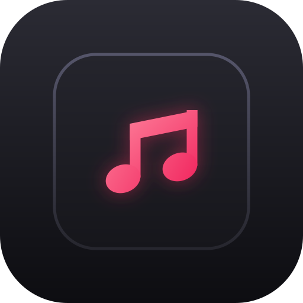

<p align="center">
  
</p>

<h1 align="center">Apple Music for Stream Deck (Windows)</h1>

<p align="center">
  Control the <b>Apple Music app for Windows</b> (the Microsoft Store app, not iTunes) from an Elgato Stream Deck:
  album cover on a key, play/pause, next/previous, shuffle and repeat.
</p>

> Unofficial project, not affiliated with Apple or Elgato. Apple Music is a trademark of Apple Inc.

## Status

| Part | State |
| --- | --- |
| Helper `AppleMusicBridge.exe` (talks to Apple Music) | done, ready to test on Windows |
| Logo and icons | done (`plugin/com.panix8th.applemusic.sdPlugin/imgs`) |
| Stream Deck plugin (the actions) | next step |
| Stream Deck + dial: Apple Music volume | phase 2, after the plugin works |

## How it works

```
Stream Deck app ──WebSocket (Elgato SDK)── plugin (Node.js)
                                              │  stdin/stdout, one JSON object per line
                                         AppleMusicBridge.exe (.NET 8)
                                              │  Windows System Media Transport Controls
                                         Apple Music for Windows
```

- Apple Music for Windows publishes what it plays through Windows' **System Media Transport Controls** (the
  same API that drives the media flyout and the keyboard media keys). The helper reads and controls exactly
  that session, matched by its `SourceAppUserModelId`; Spotify, browsers etc. are ignored.
  The iTunes COM API is not used anywhere: it does not exist for this app.
- The helper is **event driven** (`SessionsChanged`, `MediaPropertiesChanged`, `PlaybackInfoChanged`,
  `TimelinePropertiesChanged`): no polling loop.
- The plugin starts the helper once, restarts it if it crashes and stops it on exit. The helper also exits
  by itself when the plugin goes away, so it can never be left behind.
- Apple Music is **never launched** by the plugin. When it isn't running, the keys are shown dimmed.

The wire format is documented in [docs/PROTOCOL.md](docs/PROTOCOL.md).

## Actions

| Action | Key shows | Press |
| --- | --- | --- |
| **Now Playing** | album cover (144×144), song title as the key title (long titles scroll) | brings the Apple Music window to the front, if Windows allows it |
| **Play/Pause** | ▶ or ❚❚, always in sync with the real playback state (app, media keys, ...) | play / pause |
| **Next** | ▶❙ | next track |
| **Previous** | ❙◀ | previous track |
| **Shuffle** | off / on (pink + dot), crossed out if Apple Music doesn't support it | toggle |
| **Repeat** | off / all / one, crossed out if not supported | off → all → one → off |
| **Volume** (Stream Deck +, phase 2) | cover, title and volume on the touch strip | rotate = volume, press = mute |


## Requirements

To use it:

- Windows 10 or 11 (x64) with the [Apple Music](https://apps.microsoft.com/detail/9PFHDD62MXS1) app from the
  Microsoft Store
- [Stream Deck](https://www.elgato.com/s/downloads) app **7.1 or newer** (required by Stream Deck SDK v3)

To build it:

- [Node.js](https://nodejs.org/) **24 or newer** (required by `@elgato/streamdeck` v3 and the Stream Deck CLI)
- [.NET 8 SDK](https://dotnet.microsoft.com/download/dotnet/8.0) (only for building the helper; the built exe is
  self-contained and needs no .NET on the machine running Stream Deck)
- Stream Deck CLI:
  ```powershell
  npm install -g @elgato/cli
  ```
  If PowerShell refuses to run `streamdeck`, allow local scripts once:
  ```powershell
  Set-ExecutionPolicy -ExecutionPolicy RemoteSigned -Scope CurrentUser
  ```

## Repository layout

```
helper/
  AppleMusicBridge/          C# helper (net8.0-windows10.0.19041.0)
  AppleMusicBridge.Tests/    unit tests for the platform-neutral parts (protocol, state logic)
plugin/
  com.panix8th.applemusic.sdPlugin/
    imgs/                    generated icons (PNG @1x/@2x) - included in the plugin
  icons/
    glyphs/*.svg             icon sources, 24×24, single colour
    logo.svg                 logo source
    build-icons.mjs          regenerates every PNG (npm run icons)
docs/
  PROTOCOL.md                helper <-> plugin protocol
  PLAN.md                    agreed design decisions
```

## Building the helper

```powershell
dotnet publish helper/AppleMusicBridge/AppleMusicBridge.csproj -c Release -o helper/publish
```

This produces `helper/publish/AppleMusicBridge.exe` (about 40 MB: it bundles the .NET runtime). Unit tests:

```powershell
dotnet test helper/AppleMusicBridge.sln
```

## Testing the helper on its own

You can try the helper in a terminal before the Stream Deck plugin exists.

1. Start Apple Music and play a song.
2. List every media session Windows knows about, and every process with "apple" or "music" in its name:
   ```powershell
   .\helper\publish\AppleMusicBridge.exe --list-sessions
   ```
   The Apple Music line is marked `<== matched as Apple Music`. Its quoted ID is the `SourceAppUserModelId`.
3. Run the helper interactively with verbose logging:
   ```powershell
   .\helper\publish\AppleMusicBridge.exe --debug
   ```
   - Lines starting with `{` are protocol messages (stdout): `hello`, then a `state` line every time something
     changes. In a terminal the `albumArt` value is shortened; the real 144×144 cover is saved to
     `%TEMP%\AppleMusicBridge\cover.png` in debug mode.
   - Lines with a time stamp and `[DEBUG]`/`[INFO]` are logs (stderr): every session's ID, raw media and
     playback fields, which controls Apple Music reports as supported.
   - Type a command and press Enter: `togglePlayPause`, `play`, `pause`, `next`, `previous`, `toggleShuffle`,
     `cycleRepeat`, `focus`, `refresh`, `ping`. JSON works too: `{"id":1,"cmd":"next"}`. Each command answers
     with a `result` line.
   - Quit with Ctrl+Z then Enter (closes stdin, like the plugin does), or Ctrl+C.

Options: `--debug`, `--list-sessions`, `--parent-pid <pid>` (exit when that process exits; the plugin uses it),
`--help`.

## Plugin: build, link, debug, package

> The plugin code is the next step; these are the commands it will use.

```powershell
cd plugin
npm install
npm run build          # helper + plugin -> com.panix8th.applemusic.sdPlugin/bin
streamdeck link com.panix8th.applemusic.sdPlugin
streamdeck restart com.panix8th.applemusic
```

- `streamdeck link` installs the plugin folder into Stream Deck as a link, so rebuilding is enough to update it.
  `streamdeck restart com.panix8th.applemusic` reloads it (including `manifest.json`). `npm run watch` rebuilds
  and restarts automatically on every change.
- Logs: `plugin/com.panix8th.applemusic.sdPlugin/logs/com.panix8th.applemusic.0.log` (the helper's stderr is
  forwarded there under the `Helper` scope). Stream Deck's own logs are in `%appdata%\Elgato\StreamDeck\logs\`.
- Debugging: `streamdeck dev` turns on developer mode; the manifest's `"Nodejs": { "Debug": "enabled" }` lets you
  attach a Node.js debugger (for example VS Code) to the running plugin.
- If the plugin doesn't appear after installing or updating Stream Deck, restart the Stream Deck app (it may be
  running elevated after an update).

Packaging into an installable `.streamDeckPlugin` file:

```powershell
streamdeck validate plugin/com.panix8th.applemusic.sdPlugin
streamdeck pack plugin/com.panix8th.applemusic.sdPlugin --output dist/
```

Double-clicking `dist/com.panix8th.applemusic.streamDeckPlugin` installs it.

## Icons

All images are generated from SVG sources, so they stay consistent:

| Source | Output (`plugin/com.panix8th.applemusic.sdPlugin/imgs/`) | Size @1x / @2x |
| --- | --- | --- |
| `icons/logo.svg` | `plugin/marketplace.png` (plugin icon) | 256 / 512 |
| `icons/glyphs/note.svg` in a key outline | `plugin/category-icon.png` (white on transparent) | 28 / 56 |
| `icons/glyphs/*.svg` | `actions/<action>/icon.png` (action list, white on transparent) | 20 / 40 |
| `icons/glyphs/*.svg` on a key background | `actions/<action>/key-*.png` (key images) | 72 / 144 |

Style: dark key background, white glyph, pink accent `#FF4D6D` plus a dot for "on", 28 % opacity for "Apple Music
is not running", a slash for "not supported". To change an icon, edit the SVG and run:

```powershell
cd plugin
npm install
npm run icons
```

This also redraws [docs/images/icons-preview.png](docs/images/icons-preview.png).

## Troubleshooting

| Symptom | What to check |
| --- | --- |
| Keys stay dimmed although Apple Music is open | Play a song once: Apple Music registers its media session when it has something loaded. Then run `AppleMusicBridge.exe --list-sessions` and check that the Apple Music line is marked as matched. |
| Shuffle/Repeat crossed out | Apple Music doesn't report these controls through Windows' media API (see `controls: ... shuffle=... repeat=...` in the `--debug` log). |
| Now Playing press only flashes the taskbar button | Windows blocked the focus change (focus-stealing protection). Click the taskbar button. |
| No cover on the key | Check `%TEMP%\AppleMusicBridge\cover.png` with `--debug`; some tracks have no artwork. |
| Windows SmartScreen or antivirus warns about the exe | It is built locally and unsigned. |
