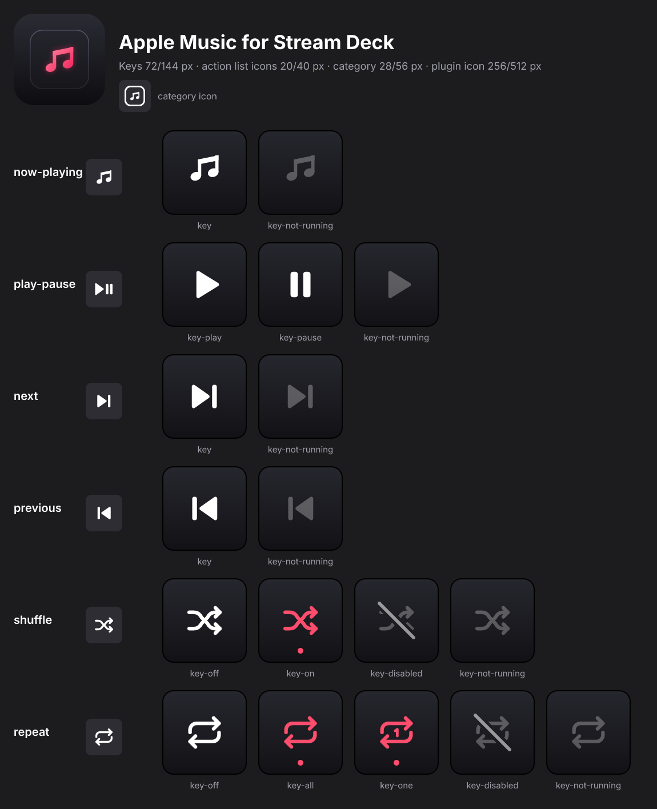

<p align="center">
  
</p>

<h1 align="center">Apple Music for Stream Deck (Windows)</h1>

<p align="center">
  Control the <b>Apple Music app for Windows</b> (the Microsoft Store app, not iTunes) from an Elgato Stream Deck:
  album cover with the song title on a key, play/pause, next, previous, shuffle and repeat.
</p>

> Unofficial project, not affiliated with Apple or Elgato. Apple Music is a trademark of Apple Inc.

## Status

| Part | State |
| --- | --- |
| Helper `AppleMusicBridge.exe` | tested on Windows: session found, track, cover, play state and commands work |
| Stream Deck plugin | tested on a Stream Deck: Now Playing, Play/Pause, Next, Previous |
| Shuffle / Repeat | new in v1.2, through UI Automation (see below); waiting for a test on Windows |

## Install

Download `com.panix8th.applemusic.streamDeckPlugin` from the
[Releases](https://github.com/panix8th/AppleMusic-StreamDeck-Plugin/releases) page and double-click it. The actions
appear in Stream Deck under **Apple Music**. The helper is included; nothing else needs to be installed.

## How it works

```
Stream Deck app ──WebSocket (Elgato SDK)── plugin (Node.js, bin/plugin.js)
                                              │  stdin/stdout, one JSON object per line
                                         AppleMusicBridge.exe (.NET 8)
                                              │  Windows System Media Transport Controls
                                         Apple Music for Windows
```

- Apple Music for Windows publishes what it plays through Windows' **System Media Transport Controls** (the
  same API behind the media flyout and the keyboard media keys). The helper reads and controls exactly that
  session, matched by its `SourceAppUserModelId` `AppleInc.AppleMusicWin_nzyj5cx40ttqa!App`; Spotify, browsers
  etc. are ignored. The iTunes COM API is not used anywhere: it does not exist for this app.
- The helper is **event driven** (`SessionsChanged`, `MediaPropertiesChanged`, `PlaybackInfoChanged`,
  `TimelinePropertiesChanged`): no polling loop. Stream Deck additionally reports when `AppleMusic.exe` starts or
  exits (`ApplicationsToMonitor`), and the plugin then asks the helper to re-check.
- The plugin starts the helper once, restarts it with a growing delay (1 s up to 30 s) if it crashes, and stops it
  with the plugin. The helper also exits by itself when the plugin goes away (stdin closed, `--parent-pid` gone).
- Apple Music is **never launched** by the plugin. While it isn't running, the keys are dimmed.
- **Shuffle and repeat** are not offered by Apple Music to Windows' media controls (`IsShuffleEnabled` and
  `IsRepeatEnabled` are false). The helper therefore uses **UI Automation**, the accessibility API screen readers
  use: it finds the Shuffle and Repeat buttons in Apple Music's player bar, presses them, reads their state and
  gets notified when they change. No mouse clicks, and the window is not brought to the front. If Apple Music
  has no window open, these two keys show as crossed out.

The wire format is documented in [docs/PROTOCOL.md](docs/PROTOCOL.md).

## Actions

| Action | Key shows | Press |
| --- | --- | --- |
| **Now Playing** | album cover (144×144) and the song title as key title; long titles scroll | brings the Apple Music window to the front (if Windows allows it) |
| **Play/Pause** | ▶ or ❚❚, always following the real playback state (app, media keys, ...) | play / pause; in a multi-action choose "Play" or "Pause" |
| **Next Track** | ▶❙ | next track |
| **Previous Track** | ❙◀ | previous track |
| **Shuffle** | off / on; crossed out when Apple Music's button can't be reached | toggle |
| **Repeat** | off / all / one; crossed out when Apple Music's button can't be reached | off → all → one → off |

There is no settings panel: nothing needs configuring. Stream Deck's own title options (font, size, alignment,
show/hide) still apply.



## Requirements

To use it:

- Windows 10 or 11 (x64) with the [Apple Music](https://apps.microsoft.com/detail/9PFHDD62MXS1) app from the
  Microsoft Store
- [Stream Deck](https://www.elgato.com/s/downloads) app **7.1 or newer** (required by Stream Deck SDK v3)

To build it:

- [Node.js](https://nodejs.org/) **24 or newer** (required by `@elgato/streamdeck` v3 and the Stream Deck CLI)
- [.NET 8 SDK](https://dotnet.microsoft.com/download/dotnet/8.0), only for building the helper. The built exe is
  self-contained and needs no .NET on the machine running Stream Deck. Without the SDK you can download
  `AppleMusicBridge.exe` from the releases and put it in `plugin/com.panix8th.applemusic.sdPlugin/bin/`.
- Stream Deck CLI:
  ```powershell
  npm install -g @elgato/cli
  ```
  If PowerShell refuses to run `streamdeck`, allow local scripts once:
  ```powershell
  Set-ExecutionPolicy -ExecutionPolicy RemoteSigned -Scope CurrentUser
  ```

## Repository layout

```
helper/
  AppleMusicBridge/            C# helper (net8.0-windows10.0.19041.0, self-contained single-file exe)
  AppleMusicBridge.Tests/      unit tests for the platform-neutral parts
plugin/                        Stream Deck plugin, scaffolded with `streamdeck create`
  src/plugin.ts                entry point: starts the helper, registers the actions
  src/bridge/                  helper process manager, protocol types, Apple Music state
  src/actions/                 the six actions, key views, title marquee
  test/                        unit tests (vitest), including a fake helper that speaks the protocol
  scripts/build-helper.mjs     builds AppleMusicBridge.exe into the plugin's bin folder
  icons/                       SVG sources of all icons + build-icons.mjs
  com.panix8th.applemusic.sdPlugin/
    manifest.json
    imgs/                      generated icons (PNG @1x/@2x)
    bin/                       build output: plugin.js, AppleMusicBridge.exe (not in git)
docs/
  PROTOCOL.md                  helper <-> plugin protocol
  PLAN.md                      design decisions
.github/workflows/release.yml  builds, tests and publishes a release
```

## Developing the plugin

```powershell
cd plugin
npm install
npm run build          # AppleMusicBridge.exe (dotnet publish) + plugin.js (rollup)
streamdeck dev         # once: enables Stream Deck's developer mode
streamdeck link com.panix8th.applemusic.sdPlugin
streamdeck restart com.panix8th.applemusic
```

- `streamdeck link` installs the plugin folder into Stream Deck as a link, so rebuilding is enough to update it;
  `streamdeck restart com.panix8th.applemusic` reloads it (including `manifest.json`).
- `npm run watch` rebuilds `plugin.js` and restarts the plugin on every change. `npm run build:plugin` builds only
  `plugin.js`, `npm run build:helper` only the exe. Stop the plugin before rebuilding the exe, since Windows
  locks a running exe:
  ```powershell
  streamdeck stop com.panix8th.applemusic
  ```
- Tests: `npm test` (plugin) and `dotnet test ..\helper\AppleMusicBridge.sln` (helper). `npm run typecheck`,
  `npm run validate`.
- Logs: `plugin/com.panix8th.applemusic.sdPlugin/logs/com.panix8th.applemusic.0.log`. The helper's own log lines
  appear there under the `Helper` scope; set `HELPER_DEBUG = true` in `src/plugin.ts` to get its verbose
  `--debug` output too. Stream Deck's logs are in `%appdata%\Elgato\StreamDeck\logs\`.
- Debugging: with developer mode on, the manifest's `"Nodejs": { "Debug": "enabled" }` lets you attach a
  Node.js debugger; `.vscode/launch.json` has an "Attach to Plugin" configuration.
- If the plugin doesn't appear after installing or updating Stream Deck, restart the Stream Deck app (it may be
  running elevated after an update).

### Packaging

```powershell
cd plugin
npm run pack
```

This builds everything, validates it and writes `dist/com.panix8th.applemusic.streamDeckPlugin`. Same as:

```powershell
streamdeck pack com.panix8th.applemusic.sdPlugin --output ../dist --force
```

### Releasing

Actions → **Release** → *Run workflow*, with a new tag such as `v1.1.0`. GitHub builds and tests the helper and
the plugin on Windows, stamps the version from the tag, and publishes a release with the `.streamDeckPlugin`,
the standalone `AppleMusicBridge.exe` and SHA-256 checksums.

## The helper on its own

`AppleMusicBridge.exe` can be run in a terminal to see exactly what Windows reports:

```powershell
.\AppleMusicBridge.exe --list-sessions
```

Prints every media session (the Apple Music one is marked `<== matched as Apple Music`) and every process with
"apple" or "music" in its name, then exits.

```powershell
.\AppleMusicBridge.exe --dump-ui
```

Shows which of Apple Music's player-bar controls UI Automation sees (name, id, toggle state, position), which
ones were picked as Shuffle and Repeat, and the state read from them. Send this output if those keys don't work.

```powershell
.\AppleMusicBridge.exe --debug
```

Prints a `state` line on every change (the `albumArt` value is shortened in a terminal; the 144×144 cover is
saved to `%TEMP%\AppleMusicBridge\cover.png`) plus verbose logs. Type a command and press Enter:
`togglePlayPause`, `play`, `pause`, `next`, `previous`, `toggleShuffle`, `cycleRepeat`, `focus`, `refresh`,
`ping`, or JSON like `{"id":1,"cmd":"next"}`. Quit with Ctrl+Z, Enter (or Ctrl+C).

Build it with:

```powershell
dotnet publish helper/AppleMusicBridge/AppleMusicBridge.csproj -c Release -o helper/publish
```

## Icons

All images are generated from SVG sources:

| Source | Output (`plugin/com.panix8th.applemusic.sdPlugin/imgs/`) | Size @1x / @2x |
| --- | --- | --- |
| `icons/logo.svg` | `plugin/marketplace.png` (plugin icon) | 256 / 512 |
| `icons/glyphs/note.svg` in a key outline | `plugin/category-icon.png` (white on transparent) | 28 / 56 |
| `icons/glyphs/*.svg` | `actions/<action>/icon.png` (action list, white on transparent) | 20 / 40 |
| `icons/glyphs/*.svg` on a key background | `actions/<action>/key-*.png` (key images) | 72 / 144 |

Style: dark key background, white glyph, pink accent `#FF4D6D` plus a dot for "on", 28 % opacity for "Apple Music
is not running", a slash for "not supported". To change an icon, edit the SVG and run `npm run icons` in
`plugin/`. This also redraws [docs/images/icons-preview.png](docs/images/icons-preview.png).

## Troubleshooting

| Symptom | What to check |
| --- | --- |
| Keys stay dimmed although Apple Music is open | Play a song once: Apple Music registers its media session when it has something loaded. Run `AppleMusicBridge.exe --list-sessions` to see what Windows reports. |
| All keys dimmed and Now Playing has no text | The helper isn't running. The plugin log says why (for example `AppleMusicBridge.exe not found`). |
| Shuffle/Repeat crossed out or not reacting | Apple Music's window must be open (minimized is fine). Otherwise run `AppleMusicBridge.exe --dump-ui` while Apple Music is open and share the output: it shows what Apple Music's player bar offers. |
| Now Playing press only flashes the taskbar button | Windows blocked the focus change (focus-stealing protection). Click the taskbar button. |
| No cover on the key | Some tracks have no artwork. With `--debug` the helper saves the cover it got to `%TEMP%\AppleMusicBridge\cover.png`. |
| Windows SmartScreen or antivirus warns about the exe | The files are unsigned. |
